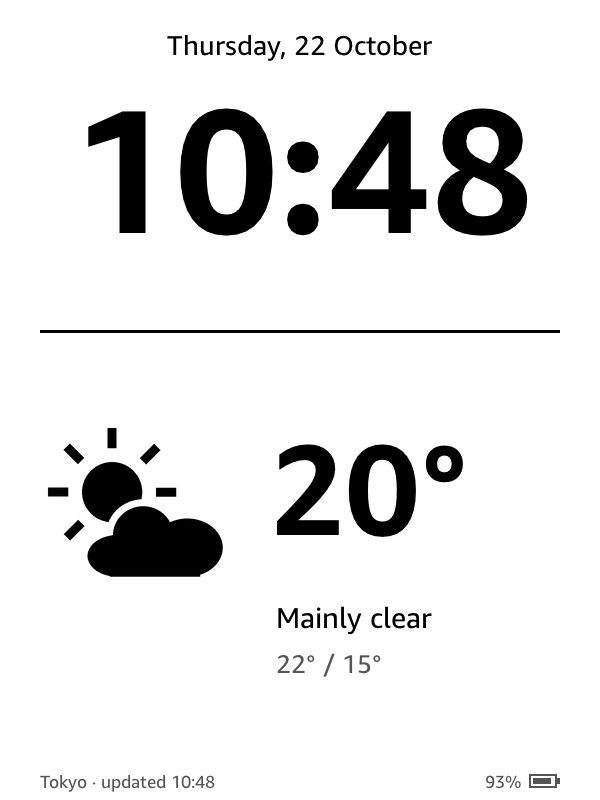
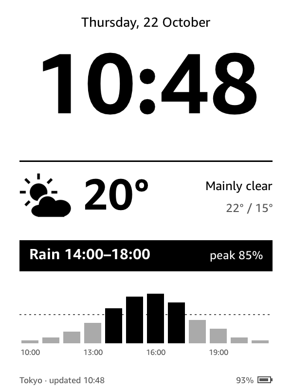

# rekindle

Turn an old Kindle into an always-on **clock and weather display**.

<p>
  
  
</p>

- Large clock, updated every minute
- Temperature, conditions and today's high/low from [Open-Meteo](https://open-meteo.com/) (no API key)
- Rain only when it matters: on a dry day nothing about rain is shown; when rain is falling or due within
  12 hours, a black banner such as **Rain 14:00–18:00 · peak 85%** appears above an hourly chart of the
  chance of rain (black bars are the rainy hours)
- Quiet status bar: place, last weather update, and battery (turns black below 20 %); the power button returns to the normal Kindle UI
- Runs entirely on the Kindle (shell script + [FBInk](https://github.com/NiLuJe/FBInk)), no server needed

Tested on a Kindle 7th gen (KT2, 600×800) with firmware 5.8.11. Other models in
[WinterBreak's range](https://kindlemodding.org/jailbreaks.json) (5.6.1.1–5.18.0.2) should follow the same
setup; the screen layout assumes 600×800.

## Usage

You need a Mac or Linux machine, a USB cable, and 2.4 GHz Wi-Fi. Each script prints what to do on the Kindle next.

```sh
scripts/fetch-deps.sh                     # download pinned jailbreak packages into vendor/
scripts/prepare-jailbreak.sh              # USB: stage WinterBreak, fill storage   → Kindle: Store → WinterBreak
scripts/stage-hotfix.sh                   # USB: stage hotfix                      → Kindle: Update Your Kindle, Run Hotfix
scripts/stage-tools.sh                    # USB: block updates, KUAL, MRPI, SSH    → Kindle: type ;log mrpi in search
scripts/setup-ssh.sh                      # USB: SSH over Wi-Fi                    → Kindle: restart
export KINDLE_HOST=$(scripts/find-kindle.sh)
scripts/deploy.sh                         # install the dashboard                 → Kindle: KUAL → Start dashboard
```

Set your location and timezone in `kindle/extensions/rekindle/rekindle.conf` before deploying
(defaults: Tokyo). Keep the Kindle on a wall charger.

- Step-by-step guide with checks for each phase: [docs/guide.md](docs/guide.md)
- Problems and fixes: [docs/troubleshooting.md](docs/troubleshooting.md)
- AI agent skill that walks through the setup: [skill/kindle-dashboard](skill/kindle-dashboard/SKILL.md)

## Credits & license

Built on [WinterBreak](https://github.com/KindleModding/WinterBreak), the
[Universal Hotfix](https://github.com/KindleModding/Hotfix), [PEKI](https://github.com/KindleTweaks/PEKI)/KUAL,
MRPI, [USBNetwork](https://www.mobileread.com/forums/showthread.php?t=225030) and FBInk; these are downloaded
from their authors, not redistributed. Weather by Open-Meteo (CC BY 4.0).

Jailbreaking voids warranties and can brick devices; proceed at your own risk.
Code in this repo: [MIT](LICENSE).
